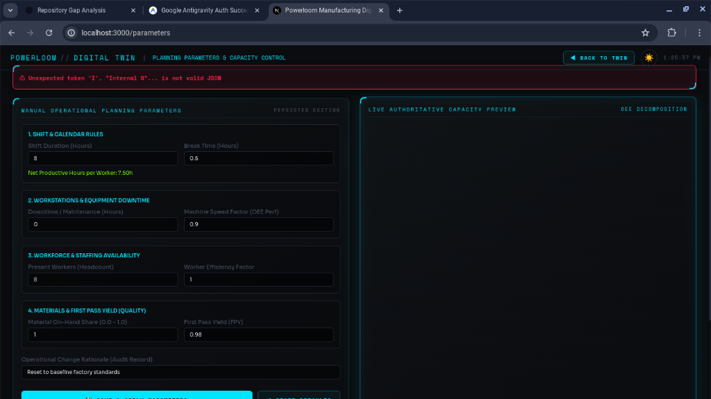

# APEX-Twin — Automotive Cyber-Physical Digital Twin & Adaptive Capacity Engine

[](https://nextjs.org/)
[](https://fastapi.tiangolo.com/)
[](https://python.org/)
[](https://lightgbm.readthedocs.io/)
[](https://threejs.org/)
[](https://pytest.org/)
[](LICENSE)

> **APEX-Twin** (**A**utomotive **P**roduction **E**xecution & e**X**treme Capacity Digital **Twin**) is an Industry 4.0 cyber-physical control platform designed for electric vehicle (EV) manufacturing plants. It couples interactive 3D floor telematics with authoritative OEE decomposition, real-time bottleneck detection, and an MLOps Champion-Challenger LightGBM quantile regression pipeline.

---

## 📸 Application Preview


*Live Operational Planning Parameters, Real-Time OEE Decomposition, 7-Day Planning Horizon Simulation, and Persistent Audit Logging.*

---

## 🏭 1. The 7-Department Automotive Manufacturing Plant

APEX-Twin models the complete production sequence of an electric passenger vehicle across 7 physical workstations:

| Department | Code | Responsibilities & Automation | Primary Workstation Components |
|---|:---:|---|---|
| **Logistics** | `LOGISTICS` | Material intake, staging buffers, AGV routing | Automated Staging, Battery Cell Storage, Coil Depots |
| **Stamping** | `STAMPING` | 2,500T hydraulic sheet metal stamping press | Reciprocating Upper Die, Guide Columns, Uncoiler |
| **BIW Welding** | `WELDING` | Robotic unibody / Body-in-White framing fixture | Dual 6-Axis Welding Robots, Flash Shield, Arc Welder |
| **Paint & Surface** | `PAINT` | Cleanroom pressurized electrostatic primer & clearcoat | Gloss Body Shell, Dual Bell Atomizers, Spray Cones |
| **Powertrain** | `POWERTRAIN` | 82 kWh skateboard battery & dual e-axle marriage | Structural Battery Pack, Drive Motors, HV Busbars |
| **Final Assembly** | `ASSEMBLY` | Vehicle chassis marriage, suspension, wheels, lighting | Hydraulic Lift Jig, Wheel Stations, LED Beacon |
| **Quality & Dynamo** | `QUALITY` | 4-wheel end-of-line chassis dynamometer & optical laser QA | Dyno Rollers, Laser Inspection Arch, Calibration Rigs |

---

## ⚡ 2. Core Capabilities

1. **Authoritative Capacity & OEE Decomposition**:
   $$\text{Gross Hours} = \text{Workstations} \times \text{Shift Duration} \times \text{Shifts/Day}$$
   $$\text{Net Hours} = \text{Gross Hours} - (\text{Break Hours} \times \text{Workstations} \times \text{Shifts/Day})$$
   $$\text{Available Hours} = \max(0, \text{Net Hours} - \text{Downtime Hours})$$
   $$\text{OEE} = \text{Availability} \times \text{Performance (Speed)} \times \text{Quality (First Pass Yield)}$$
   $$\text{Usable Hours} = \min(\text{Available Machine Hours}, \text{Active Labour Hours}) \times \text{OEE} \times \text{Material Factor}$$
   - Automatically detects and flags whether lines are **`MACHINE_BOUND`** or **`LABOUR_BOUND`**.

2. **Champion-Challenger MLOps Retraining Pipeline**:
   - Trains LightGBM Quantile Regressors ($\alpha \in \{0.50, 0.75, 0.90\}$) to forecast throughput uncertainty under varying shop-floor conditions.
   - Enforces strict **chronological train/validation/test holdout splits** (70% / 15% / 15%) to prevent data leakage.
   - Evaluates challengers against an **automated safety gate** (blocks promotion if MAE regresses on Overload segments or bottleneck departments).
   - Provides single-click instant model rollback.

3. **Interactive 3D Factory Twin**:
   - Built with Three.js and React Three Fiber featuring animated pod machinery, moving material transfer particles, dark/light control-room modes, and responsive inspection modals.

4. **Interactive Test Case Switcher**:
   - **`TC-01 (Baseline Nominal)`**: Balanced line takt (88% utilization, 38 operators, 0 chokes).
   - **`TC-02 (Critical Marriage Choke)`**: Assembly overload (104% load, starvation risk, automated overtime recommendation).
   - **`TC-03 (Stamping Breakdown)`**: Unplanned hydraulic press outage (upstream starvation, 52% plant efficiency).
   - **`TC-04 (High-Demand EV Surge)`**: +35% order volume spike on 82 kWh battery packs (3-shift scheduling rebalance).

---

## 🏗️ 3. System Architecture

```
                       ┌──────────────────────────────────────────────┐
                       │   FRONTEND (Next.js 16.4 + Three.js / R3F)    │
                       │   Control Room UI · 3D Canvas · SVG Charts   │
                       └──────────────────────┬───────────────────────┘
                                              │ HTTP Proxy (:3000 -> :8000)
                                              ▼
                       ┌──────────────────────────────────────────────┐
                       │          BACKEND (FastAPI + Uvicorn)          │
                       │  Authoritative Capacity · Routing · MLOps    │
                       └──────┬───────────────────────┬───────────────┘
                              │                       │
              ┌───────────────▼────────┐      ┌───────▼────────────────┐
              │ SQLite + Alembic DB    │      │ ML Retraining Worker   │
              │ Parameter Audit Logs   │      │ LightGBM (P50/P75/P90) │
              │ Model Run Registry     │      │ Safety Gate Evaluation │
              └────────────────────────┘      └────────────────────────┘
```

---

## 🚀 4. Quickstart & Verification

### Prerequisites
- Python 3.11+
- Node.js 18+ & npm

### Backend Setup
```bash
cd backend
python -m venv venv
source venv/bin/activate  # On Windows: venv\Scripts\activate

pip install -r requirements.txt
python -m app.db.seed

# Start FastAPI server
uvicorn app.main:app --port 8000 --host 0.0.0.0
```
*API documentation live at `http://localhost:8000/docs`.*

### Frontend Setup
```bash
cd frontend
npm install
npm run build
npm start
# Or for development: npm run dev
```
*Digital Twin application live at `http://localhost:3000`.*

---

## 🧪 5. Automated Test Suite

Run the full pytest suite (all 39 tests passing):
```bash
pytest backend/tests -v
```

```
backend/tests/test_capacity.py ....                                      [ 10%]
backend/tests/test_main.py .                                             [ 12%]
backend/tests/test_ml.py ....                                            [ 23%]
backend/tests/test_monitoring.py ...                                     [ 30%]
backend/tests/test_phase1.py ...                                         [ 38%]
backend/tests/test_planning_capacity_authoritative.py .....              [ 51%]
backend/tests/test_retraining_flow.py ......                             [ 66%]
backend/tests/test_scheduling.py ...                                     [ 74%]
backend/tests/test_simulation.py ..                                      [ 79%]
backend/tests/test_tracking.py ....                                      [ 89%]
backend/tests/test_workforce.py ....                                     [100%]

======================= 39 passed in 58.76s =======================
```

---

## 📜 6. License
MIT License. Developed for Advanced Automotive Manufacturing Digital Twin Intelligence.
